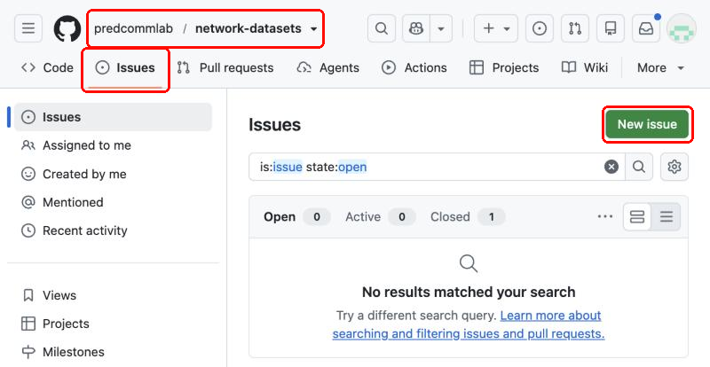
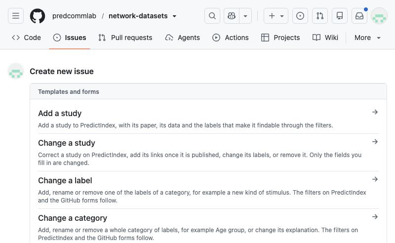
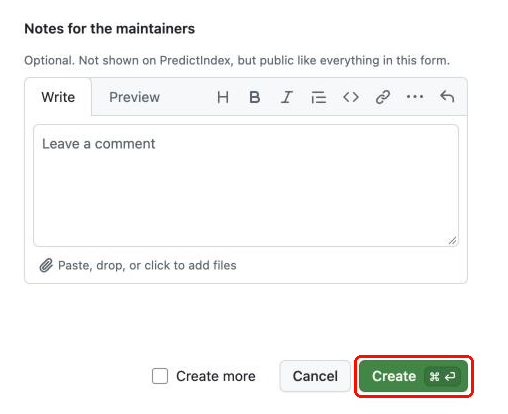
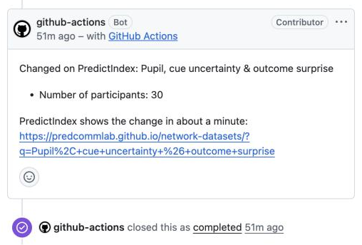
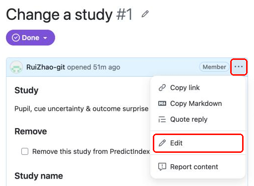
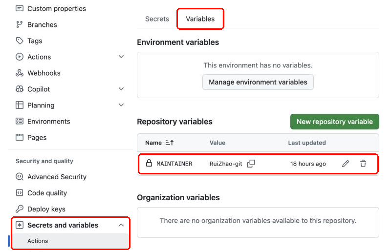
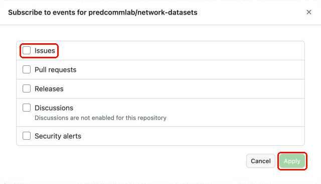

# Looking after PredictIndex

Last updated: **26 November 2026**
<!-- When you change this guide, change this date too. -->

*For the people in the lab who look after PredictIndex. The current version of
this guide is `MAINTENANCE.md` in the repository on GitHub. A PDF is a printed
copy: if its date is older than the one on GitHub, it is out of date.*

## 1. The parts of PredictIndex

PredictIndex is looked after by the lab. These are its parts and what each one
is for:

| Part | What it is for |
| ------------- | ------------------------------- |
| **The page**: [predcommlab.github.io/network-datasets](https://predcommlab.github.io/network-datasets/) | Lists the studies. Visitors can search, filter by labels and download the studies they see as an Excel table. |
| **The GitHub repository**: [github.com/predcommlab/network-datasets](https://github.com/predcommlab/network-datasets) | Holds everything the page shows: one file per study in the folder `studies`, and the categories with their labels in the file `options.json`. |
| **The GitHub forms**: [github.com/predcommlab/network-datasets/issues/new/choose](https://github.com/predcommlab/network-datasets/issues/new/choose) | How you change PredictIndex (sections 2 to 4). A program carries out each form, updates the page and replies on the form. You need to be signed in to GitHub. The forms are only for the people who look after PredictIndex: a form from anyone else is closed at once, unread. |
| **The Google Form** "Add your study to PredictIndex": [link for researchers](https://docs.google.com/forms/d/e/1FAIpQLScZ5s-y-Vw1pWGzYse1Ns0ZZnWvLxaNG9NpUlqrsu2GuPuIMA/viewform), [link for editing](https://docs.google.com/forms/d/1-mgcaKgDN48nyrk-k2S3NPfX4S9o0-g9ICRUWnkaF4Y/edit) | Where researchers outside the lab describe their study, so they never need GitHub. Send them the link for researchers when you invite them. The link for editing opens the answers and the questions (section 5). |
| **The Google Sheet** "PredictIndex: submitted studies": [link](https://docs.google.com/spreadsheets/d/1jsBNdJ39WDYY12xa2nYABqmmZYzgVSrymIOVP34mInc/edit) | Linked to the Google Form: it stores every answer, one row per answer, with the sender's e-mail address (section 5). |

The links for editing the form and the sheet open only for the people they are
shared with.

**Why the repository is public:** on the lab's free GitHub plan, GitHub publishes
a page only from a public repository; a private repository would take
PredictIndex offline. So everything in it, the forms and the replies included,
can be read by anyone (see section 8).

## 2. How to send a form

1. Sign in to GitHub and open the repository. Click **Issues**, then the green
   **New issue** button.

   
2. Choose a form (see section 3).

   
3. Fill in the form. Click **Create**.

   
4. Wait about a minute. A reply appears: what was changed, and a link. Soon
   after, PredictIndex shows the change and the form closes.

   
5. The reply says something is missing or wrong? Then nothing was changed.
   Either:
   - correct your form: **three dots** at its top right → **Edit** → change the
     text → **Update comment**, or

     
   - send a new form, and click **Close issue** on the old one.

## 3. Studies

| Form | Use it to |
| ------------- | ------------------------------- |
| Add a study | add a new study. |
| Change a study | correct a study, add its links once it is published, change its labels or its additional information, or remove it. |
| Change a label | add, rename or remove a label within a category (section 4). |
| Change a category | add, rename or remove a whole category, or change its explanation (section 4). |

### Add a study

| Field | What to write |
| ------------- | ------------------------------- |
| Study name | The title on PredictIndex. Different from all other studies. |
| Authors | First and last names, separated by commas. |
| Corresponding author | One name. PredictIndex can be filtered by it. |
| Is the study published (or available as a preprint)? | **Yes**: fill in Paper. **Not yet**: leave Paper and Data empty, and add them later with Change a study. A preprint counts as published. |
| Paper | The DOI (for example 10.1038/s41598-024-59302-1) or a link. With a DOI, Paper title can stay empty: the title is looked up. |
| Data | Link to the data, for example on OSF. Empty if the data is not public. |
| Labels | Tick all that apply (none are required). A label missing? Add it first with Change a label. |
| Additional information | Optional. Anything the labels do not cover. It is shown in the study's Details. |

### Change a study

- Choose the **Study** at the top. Only the fields you fill in are changed.
- To empty a field, write a dash (-). This works for Paper title, Paper, Data,
  Number of participants, Number of sessions, Acquisition, BIDS task label and
  Additional information. Study name, Authors and Corresponding author cannot
  be emptied.

| Field | What to write |
| ------------- | ------------------------------- |
| Is the study published (or available as a preprint)? | Once published: **Yes**, and fill in Paper (and Data, if public). **Not yet** takes the study's links off the page. |
| Additional information | The new text. It replaces the old one. |
| Labels to add, Labels to remove | Choose the labels. You do not need to know the current ones. |
| Remove | Tick it to remove the study from PredictIndex. To bring it back, use Add a study. |

## 4. Labels and categories

A category is a group of labels, for example Recording technique with the labels
EEG, fMRI and so on. Visitors filter PredictIndex by them.

### Change a label

First choose the **Category**, then:

| What should change? | What to write |
| ------------- | ------------------------------- |
| Add a label | The label under **New label**. It goes to the end of the category. For a label under another one, use a colon: "Clinical: dyslexia" appears under Clinical. |
| Rename a label | The label under **Label as it is now**, the new wording under **New label**. All studies with the label get the new wording. If the new wording is an existing label, the two become one. |
| Remove a label | The label under **Label as it is now**. It is removed from all studies; the reply lists them. |

A label cannot contain a comma.

### Change a category

| What should change? | What to write |
| ------------- | ------------------------------- |
| Add a category | Its name under **New name**, and its labels under **Labels of the new category**, one per line. An **Explanation** is optional. The category is added at the end. |
| Rename a category | Choose the **Category**, and write the new name under **New name**. The studies keep their labels. |
| Change a category's explanation | Choose the **Category**, and write the new explanation (a dash removes it). The explanation is shown with the category in the GitHub forms. |
| Remove a category | Choose the **Category**. Its labels are removed from all studies; the reply lists them. |

A category's name cannot contain a comma or a colon.

### After a change of labels or categories

1. PredictIndex's filters and the GitHub forms follow within about a minute.
2. The Google Form does **not** change by itself. Make the same change in its
   questions (section 5).

## 5. The Google Form and its sheet

- **What they are for:** researchers outside the lab describe their study in
  the Google Form "Add your study to PredictIndex". Each answer is stored as a
  row of the linked Google Sheet "PredictIndex: submitted studies". You read the
  answer and add the study to PredictIndex with the GitHub form Add a study
  (below).
- **Who can open them:** the answers contain the senders' e-mail addresses.
  So the form and the sheet are shared only with the people who look after
  PredictIndex: one of them owns both, the others are editors. When the owner
  leaves, they transfer the ownership of both in Google Drive (the new owner has
  to accept).
- **E-mail for every new answer:** in the Google Form, **Responses** → **three
  dots** → **Get email notifications for new responses**. Each person switches
  this on for themselves.
- **Its questions:** after a change with Change a label or Change a category,
  edit the same question in the Google Form (click the question, then change its
  title or options).

### Adding an answer to PredictIndex

1. Open the answer: in the Google Form (link for editing, section 1), **Responses** → **Individual**, or its
   row in the sheet.
2. Check it: the study belongs on PredictIndex, the paper link opens and belongs
   to this study, and the data link opens and is public.
3. Send a new GitHub form **Add a study** (section 2) and copy the answers into
   it:
   - name, authors, corresponding author, whether it is published, paper and
     data (only if published), number of participants;
   - tick the same labels;
   - copy the answer to "Additional information you would like to add" into
     **Additional information**, as it is.
4. Click **Create**. PredictIndex shows the study about a minute later.

Good to know:

- **Never copy the sender's e-mail address into GitHub.** You can use it to ask
  questions; GitHub is public.
- A study does not belong on PredictIndex? Do nothing.
- The answer says "published" but gives no paper? Ask the sender for the DOI,
  or choose Not yet.
- An answer written under "Other" (not one of the labels)? Add it first as a new
  label with Change a label, or put it into Additional information.

## 6. People and access

**Who looks after PredictIndex:** their GitHub user names are in **Settings →
Secrets and variables → Actions → Variables → MAINTAINER**
([direct link](https://github.com/predcommlab/network-datasets/settings/variables/actions)),
separated by spaces. Every form is assigned to them, and they are mentioned when
something goes wrong. (Only administrators of the repository see Settings.)

**Access:** **Settings → Collaborators and teams**
([direct link](https://github.com/predcommlab/network-datasets/settings/access)). Give the people who look
after PredictIndex **Admin** access (needed to change MAINTAINER), or at least
**Write** access. A form from someone without Write access is closed at once,
unread.

**E-mail for every new form:** **Watch** at the top of the repository →
**Custom** → tick **Issues** → **Apply**.

**When someone takes over**, check these four things:

1. They have Admin access to the repository.
2. Their GitHub user name is in MAINTAINER, and the names of people who left
   are taken out.
3. They are an editor (or the owner) of the Google Form and its sheet, with the
   form's e-mail notifications switched on.
4. They have this guide.

## 7. When something goes wrong

- **The reply says something is missing or wrong:** nothing was changed.
  Correct the form (section 2, step 5).
- **The reply says there was a technical problem, or there is no reply after a
  few minutes:** nothing was changed, and the page stays as it is. Edit the
  form once (**Edit** → **Update comment**) to try again.
- **An e-mail address in a form:** the form is not carried out; the reply asks
  you to remove it. GitHub keeps old versions of a form. To delete one: click
  **edited** next to the date at the top of the form → choose the old version →
  **Delete revision from history**.
- **A change was wrong:** correct it with the same forms. For example, add a
  removed study again with Add a study.

## 8. Please do not

- write e-mail addresses, or links that a study's authors do not want public
  yet, anywhere in the repository (forms included);
- change the files of the repository directly. Use the forms; a mistake in a
  file can stop PredictIndex from being updated.

The page itself (its texts, look and layout) cannot be changed with the forms.
